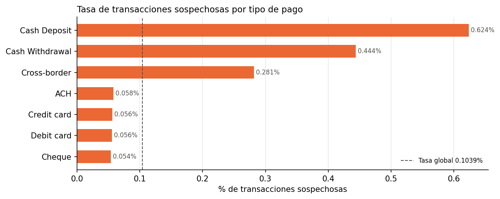

# Monitoreo transaccional PLD: reglas por tipología, segmentación por riesgo y priorización de alertas

Sistema de **monitoreo transaccional para Prevención de Lavado de Dinero (PLD)** construido como lo haría el área de cumplimiento de un banco o fintech: **reglas de alertamiento** inspiradas en la regulación mexicana y en tipologías conocidas, **segmentación de clientes por riesgo** (enfoque basado en riesgo) y un **modelo que prioriza alertas** para reducir la carga de falsos positivos sin perder casos sospechosos.

Datos: [*SAML-D*](https://www.kaggle.com/datasets/berkanoztas/synthetic-transaction-monitoring-dataset-aml) (Kaggle), dataset sintético de transacciones con etiquetas de lavado y tipologías.

> 🚧 **Proyecto en construcción.** El resumen ejecutivo se agrega al terminar todas las etapas.

> **Alcance:** los datos son sintéticos, en libras esterlinas y centrados en Reino Unido. Las reglas toman como referencia conceptos de la regulación mexicana de PLD, pero sus umbrales son **ilustrativos** y no sustituyen los establecidos en las disposiciones vigentes.

---

## Hallazgos de la exploración (etapa 1)

- **Universo:** 9,504,852 transacciones de 855,460 cuentas en 321 días (7-oct-2022 a 23-ago-2023), en promedio 29,610 por día.
- **Lo sospechoso es escaso:** 9,873 transacciones (0.1039 %, una de cada 962.7). Un sistema que nunca alerta tendría 99.8961 % de exactitud sin detectar nada; por eso se evalúa con precisión y recall.
- **El riesgo se concentra en pocos canales:** el depósito en efectivo es el 2.37 % de las transacciones pero el 14.23 % de las sospechosas (6.01 veces la tasa promedio); el retiro en efectivo tiene 4.27 veces y la transferencia internacional 2.71 veces.
- **Riesgo geográfico:** las operaciones internacionales tienen 3.14 veces la tasa promedio y las que cambian de moneda 3.24 veces.
- **El monto por sí solo no basta:** la mediana sospechosa (£5,322.79) es menor que la normal (£6,114.63), aunque en la cola es al revés (percentil 99: £419,540.08 vs. £44,938.16).
- **Camuflaje:** el 99.98 % de las cuentas que envían alguna operación sospechosa también realizan operaciones normales.
- **Fuga de información controlada:** las 28 tipologías (17 sospechosas) son 100 % normales o 100 % sospechosas, así que se excluyen de reglas y modelos.
- **Eficiencia:** con tipos de dato optimizados, la memoria se redujo 90.7 % en una muestra de 500,000 filas (de 244.5 MB a 22.8 MB).



---

## Metodología

| Etapa | Notebook | Qué se hace |
|---|---|---|
| 1 | [`01_descarga_y_exploracion`](notebooks/01_descarga_y_exploracion.ipynb) · [Abrir en Colab](https://colab.research.google.com/github/emilianomtz0189/pld-monitoreo-transaccional/blob/main/notebooks/01_descarga_y_exploracion.ipynb) | Carga optimizada en memoria; volumen, desbalance, riesgo por canal, geografía, montos, tipologías y vista por cuenta y mes. |
| 2 | [`02_reglas_monitoreo`](notebooks/02_reglas_monitoreo.ipynb) · [Abrir en Colab](https://colab.research.google.com/github/emilianomtz0189/pld-monitoreo-transaccional/blob/main/notebooks/02_reglas_monitoreo.ipynb) | Reglas de efectivo de monto alto, fraccionamiento, concentración (fan-in / fan-out), movimiento rápido de fondos, operaciones internacionales y cambio de comportamiento; precisión, recall y alertas por día de cada regla. |
| 3 | `03_segmentacion_riesgo` *(pendiente)* | Puntaje de riesgo por cuenta y niveles bajo / medio / alto. |
| 4 | `04_modelo_priorizacion` *(pendiente)* | Variables por cuenta y ventana de tiempo; validación temporal; regresión logística vs. LightGBM; PR-AUC, recall en el top-K y reducción de alertas. |
| 5 | `05_resultados` *(pendiente)* | Gráficas y conclusiones de negocio. |

## Estructura del repositorio

```
├── data/                  # Instrucciones de descarga y diccionario (el dataset no se sube)
├── notebooks/             # Un notebook por etapa, numerados
├── resultados/
│   ├── figuras/           # Gráficas usadas en este README
│   └── metricas/          # Cifras de cada etapa en JSON
├── src/
│   ├── config.py          # Rutas relativas, semilla y parámetros globales
│   ├── datos.py           # Descarga, carga optimizada, validación y respaldo
│   ├── eda.py             # Análisis exploratorio y gráficas
│   └── reglas.py          # Reglas de monitoreo y su evaluación
└── requirements.txt       # Librerías del proyecto
```

## Cómo reproducirlo

1. Abre el notebook en Google Colab con su enlace de la tabla de metodología: conecta Drive, clona el repositorio e instala `requirements.txt`.
2. La primera ejecución descarga los datos de Kaggle y los respalda en Drive (ver [`data/README.md`](data/README.md)). En local: `pip install -r requirements.txt` y coloca el CSV en `data/raw/`.
3. Rutas relativas y semilla fija (`SEMILLA = 42`). Cada notebook reconstruye lo que necesita de las etapas anteriores.

**Herramientas:** Python, pandas, NumPy, PyArrow, scikit-learn, LightGBM, Matplotlib, Google Colab.

## Autor

**José Emiliano Martínez Chavira** · Actuario (UAG, Actuaría y Ciencia de Datos) · [LinkedIn](https://www.linkedin.com/in/emiliano-martinez-861175227)
