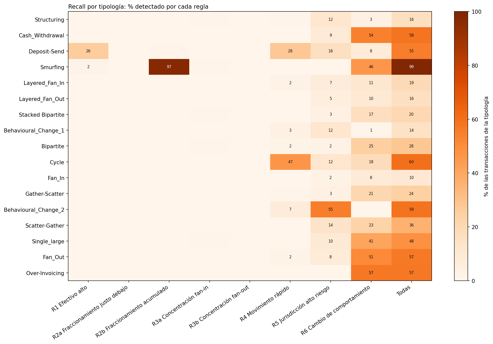
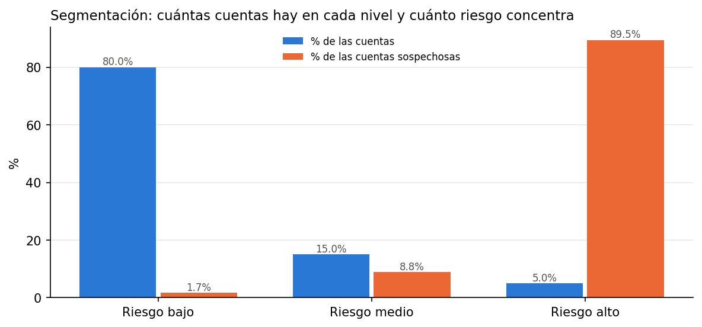
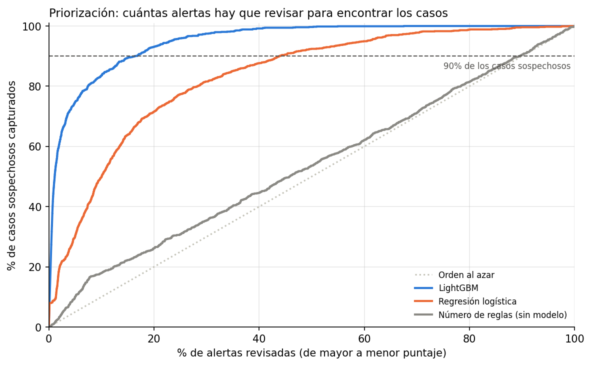

# Monitoreo transaccional PLD: reglas por tipología, segmentación por riesgo y priorización de alertas

Sistema de **monitoreo transaccional para Prevención de Lavado de Dinero (PLD)** construido como lo haría el área de cumplimiento de un banco o fintech: **reglas de alertamiento** inspiradas en la regulación mexicana y en tipologías conocidas, **segmentación de clientes por riesgo** (enfoque basado en riesgo) y un **modelo que prioriza las alertas** para reducir la carga de falsos positivos sin perder casos sospechosos.

Datos: [*SAML-D*](https://www.kaggle.com/datasets/berkanoztas/synthetic-transaction-monitoring-dataset-aml) (Kaggle), dataset sintético de 9,504,852 transacciones de 855,460 cuentas (oct-2022 a ago-2023), con etiqueta de lavado y 28 tipologías. Solo el 0.1039 % de las transacciones es sospechoso.

> **Alcance:** los datos son sintéticos, en libras esterlinas y centrados en Reino Unido. Las reglas toman como referencia conceptos de la regulación mexicana de PLD (art. 115 de la Ley de Instituciones de Crédito y sus Disposiciones), pero sus umbrales son **ilustrativos** y no sustituyen los establecidos en las disposiciones vigentes.

---

## Resumen ejecutivo

- **Las reglas tradicionales generan mucho trabajo y poco acierto:** 8 reglas en 6 familias producen **718.1 alertas por día** con **1.14 % de precisión** (99 de cada 100 alertas son falsos positivos) y detectan el **40.1 %** de las transacciones sospechosas. Es el problema central del monitoreo transaccional en la industria.
- **Diseñar por comportamiento funciona mejor que diseñar "de libro":** la regla de fraccionamiento "justo debajo del umbral" no detectó ningún caso; la versión que **acumula** depósitos chicos detectó el **97.4 % del pitufeo** (*smurfing*).
- **La segmentación concentra el riesgo:** el **5 %** de las cuentas clasificadas como riesgo alto concentra el **89.46 %** de las cuentas con actividad sospechosa (17.89 veces la tasa promedio).
- **El modelo de priorización reduce la carga de trabajo 83.5 %:** en meses que el modelo nunca vio (may-2023 a ago-2023), LightGBM encuentra el **90 %** de los casos sospechosos revisando solo el **16.46 %** de las alertas: de **669.7 a 110.2 alertas por día**. Sin modelo, ordenando por número de reglas, la reducción es de apenas 10.4 %.
- **Recomendación:** usar el modelo para **ordenar** la fila de trabajo de los analistas, no para suprimir alertas; mantener la regresión logística como referencia explicable y acompañar a LightGBM con explicaciones por alerta (SHAP) y validación independiente.

---

## Resultados principales

### 1. Reglas de monitoreo (todo el periodo, 321 días)

| Regla | Riesgo que cubre | Alertas por día | Precisión de alertas | Recall | Lo que mejor detecta |
|---|---|---|---|---|---|
| R1 Efectivo de monto alto (≥ £6,048, análogo a 7,500 USD) | Introducir efectivo ilícito | 0.8 | 100.00 % | 2.63 % | *Deposit-Send* (26 %) |
| R2a Fraccionamiento "justo debajo" (80–100 % del umbral) | Evadir el umbral de reporte | 0.1 | 0.00 % | 0.00 % | — |
| R2b Fraccionamiento acumulado | Evadir el umbral de reporte | 49.5 | 4.01 % | 9.26 % | *Smurfing* (97 %) |
| R3a Concentración (fan-in) | Juntar fondos de muchas cuentas | 13.1 | 0.29 % | 0.25 % | — |
| R3b Dispersión (fan-out) | Repartir fondos a muchas cuentas | 6.6 | 0.00 % | 0.00 % | — |
| R4 Movimiento rápido de fondos | Cuentas puente | 63.5 | 1.57 % | 5.31 % | *Cycle* (47 %) |
| R5 Jurisdicciones de alto riesgo (listas del GAFI por fecha) | Países con deficiencias en PLD | 227.6 | 1.07 % | 9.95 % | *Behavioural_Change_2* (55 %) |
| R6 Cambio de comportamiento | Operación inusual vs. su historial | 417.2 | 0.72 % | 21.31 % | *Over-Invoicing* (57 %), *Cash_Withdrawal* (54 %) |
| **Consolidado** (un caso por cuenta y semana) | | **718.1** | **1.14 %** | **40.1 %** | 3,959 de 9,873 sospechosas |

**Puntos ciegos:** el conjunto de reglas detecta poco de *Fan_In* (10.44 %), *Behavioural_Change_1* (14.47 %), *Layered_Fan_Out* (15.88 %) y *Structuring* (15.94 %).



### 2. Segmentación de cuentas por riesgo

Puntaje de 0 a 100 con seis factores ponderados por criterio experto (efectivo 25 %, historial de alertas 20 %, internacional 15 %, países del GAFI 15 %, contrapartes 15 %, monto 10 %), sin usar la etiqueta.

| Nivel | Cuentas | % de las cuentas | % de las cuentas sospechosas | Veces la tasa promedio |
|---|---|---|---|---|
| Alto | 42,773 | 5.00 % | 89.46 % | 17.89 |
| Medio | 128,319 | 15.00 % | 8.82 % | 0.59 |
| Bajo | 684,368 | 80.00 % | 1.72 % | 0.02 |



### 3. Modelo de priorización de alertas (muestra de prueba fuera de tiempo)

Unidad: caso = cuenta + semana con al menos una alerta. Entrenamiento: 156,167 casos (oct-2022 a may-2023). Prueba: 74,341 casos y 1,226 sospechosos (may-2023 a ago-2023; tasa base 1.65 %).

| Método | PR-AUC | Recall en el 10 % de mayor puntaje | Recall en el 20 % | % de alertas para 90 % de recall | Alertas por día para 90 % de recall |
|---|---|---|---|---|---|
| **LightGBM** | **0.6271** | **83.52 %** | **93.15 %** | **16.46 %** | **110.2** |
| Regresión logística | 0.1546 | 49.84 % | 71.62 % | 43.84 % | 293.6 |
| Número de reglas (sin modelo) | 0.0207 | 17.94 % | 26.18 % | 89.56 % | 599.8 |
| Revisar todo | — | — | — | 100 % | 669.7 |



---

## Conclusiones de negocio

1. **Ninguna regla sola es suficiente.** Cada regla cubre tipologías distintas: el fraccionamiento acumulado detecta el pitufeo, el movimiento rápido detecta ciclos y el cambio de comportamiento cubre la mayor variedad de esquemas. Un sistema de monitoreo necesita **cobertura de tipologías**, no una regla perfecta.
2. **Un umbral igual para todos genera falsos positivos.** Las reglas de concentración alertaron sobre todo a negocios normales con muchas contrapartes (nómina, clientes). Los umbrales deben calibrarse **por segmento de cliente**.
3. **Más reglas activadas no significa más riesgo.** Ordenar los casos por número de reglas casi no mejora al azar (PR-AUC 0.0207 vs. 0.0165). La priorización necesita un modelo que combine el comportamiento de la cuenta con su historial.
4. **Priorizar no es suprimir.** El modelo no elimina alertas: ordena la fila de trabajo para que el equipo revise primero los casos de mayor riesgo. Con la misma plantilla de analistas se cubre mucho más riesgo.

## Limitaciones y siguientes pasos

- **Datos sintéticos:** en SAML-D todo el efectivo arriba de £6,048 es sospechoso, por eso R1 tiene 100 % de precisión y es la variable más importante de LightGBM. En una institución real, la mayoría de las operaciones relevantes son legítimas.
- **Etiqueta perfecta:** en la realidad solo se conocen los casos dictaminados y reportados; aquí la etiqueta es completa.
- **Calibración:** los umbrales de concentración (percentil 99.9) se calcularon con todo el periodo, incluidos los meses de prueba; en producción deben fijarse con datos históricos.
- **Segmentación descriptiva:** se evaluó con el mismo periodo con que se construyó; su capacidad predictiva debe validarse fuera de tiempo.
- **Siguientes pasos:** explicaciones por alerta con SHAP; reglas de fan-in en ventanas de 30 días y por segmento; fraccionamiento también en transferencias; retroalimentación con los dictámenes de los analistas; monitoreo mensual de estabilidad (PSI) del modelo.

---

## Metodología

| Etapa | Notebook | Qué se hace |
|---|---|---|
| 1 | [`01_descarga_y_exploracion`](notebooks/01_descarga_y_exploracion.ipynb) · [Abrir en Colab](https://colab.research.google.com/github/emilianomtz0189/pld-monitoreo-transaccional/blob/main/notebooks/01_descarga_y_exploracion.ipynb) | Carga optimizada en memoria (−90.7 % en una muestra de 500,000 filas); volumen, desbalance, riesgo por canal, geografía, montos, tipologías y verificación de fuga de información. |
| 2 | [`02_reglas_monitoreo`](notebooks/02_reglas_monitoreo.ipynb) · [Abrir en Colab](https://colab.research.google.com/github/emilianomtz0189/pld-monitoreo-transaccional/blob/main/notebooks/02_reglas_monitoreo.ipynb) | Seis familias de reglas (efectivo alto, fraccionamiento, concentración, movimiento rápido, alto riesgo GAFI, cambio de comportamiento); alertas por día, precisión, recall y recall por tipología. |
| 3 | [`03_segmentacion_riesgo`](notebooks/03_segmentacion_riesgo.ipynb) · [Abrir en Colab](https://colab.research.google.com/github/emilianomtz0189/pld-monitoreo-transaccional/blob/main/notebooks/03_segmentacion_riesgo.ipynb) | Puntaje de riesgo por cuenta con factores ponderados y niveles bajo / medio / alto. |
| 4 | [`04_modelo_priorizacion`](notebooks/04_modelo_priorizacion.ipynb) · [Abrir en Colab](https://colab.research.google.com/github/emilianomtz0189/pld-monitoreo-transaccional/blob/main/notebooks/04_modelo_priorizacion.ipynb) | 33 variables por cuenta y semana (solo información pasada); validación fuera de tiempo; regresión logística vs. LightGBM; PR-AUC, recall en el top-K y reducción de alertas. |

## Hallazgos de la exploración (etapa 1)

- **El riesgo se concentra en pocos canales:** el depósito en efectivo es el 2.37 % de las transacciones pero el 14.23 % de las sospechosas (6.01 veces la tasa promedio); el retiro en efectivo tiene 4.27 veces y la transferencia internacional 2.71 veces.
- **Riesgo geográfico:** las operaciones internacionales tienen 3.14 veces la tasa promedio y las que cambian de moneda 3.24 veces.
- **El monto por sí solo no basta:** la mediana sospechosa (£5,322.79) es menor que la normal (£6,114.63), aunque en la cola es al revés (percentil 99: £419,540.08 vs. £44,938.16).
- **Camuflaje:** el 99.98 % de las cuentas que envían alguna operación sospechosa también realizan operaciones normales.
- **Fuga de información controlada:** las 28 tipologías (17 sospechosas) son 100 % normales o 100 % sospechosas, así que se excluyen de reglas y modelos y solo se usan para analizar resultados.

## Estructura del repositorio

```
├── data/                  # Instrucciones de descarga y diccionario (el dataset no se sube)
├── notebooks/             # Un notebook por etapa, numerados
├── resultados/
│   ├── figuras/           # Gráficas usadas en este README
│   └── metricas/          # Cifras de cada etapa en JSON (fuente de todas las cifras)
├── src/
│   ├── config.py          # Rutas relativas, semilla y parámetros globales
│   ├── datos.py           # Descarga, carga optimizada, validación y respaldo en Drive
│   ├── eda.py             # Análisis exploratorio y gráficas
│   ├── reglas.py          # Reglas de monitoreo y su evaluación
│   ├── segmentacion.py    # Puntaje y niveles de riesgo por cuenta
│   └── modelo.py          # Casos, variables y métricas de priorización
└── requirements.txt       # Versiones fijas de las librerías
```

## Cómo reproducirlo

1. Abre los notebooks en orden en Google Colab con su enlace de la tabla de metodología: cada uno conecta Drive, clona el repositorio e instala `requirements.txt`.
2. El notebook 01 descarga los datos de Kaggle y los respalda en Drive (ver [`data/README.md`](data/README.md)); los siguientes los cargan desde ahí en segundos. En local: `pip install -r requirements.txt` y coloca el CSV en `data/raw/`.
3. Rutas relativas, semilla fija (`SEMILLA = 42`) y versiones de librerías fijas. Todas las cifras de este README salen de `resultados/metricas/`.

**Herramientas:** Python, pandas, NumPy, PyArrow, scikit-learn, LightGBM, Matplotlib, Google Colab.

## Autor

**José Emiliano Martínez Chavira** · Egresado de Actuaría y Ciencia de Datos (UAG) · [LinkedIn](https://www.linkedin.com/in/emiliano-martinez-861175227)
